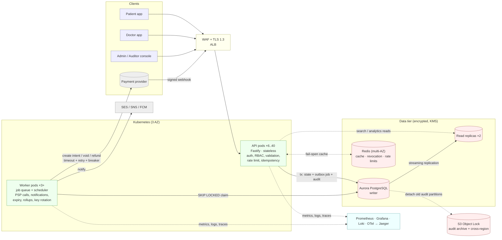
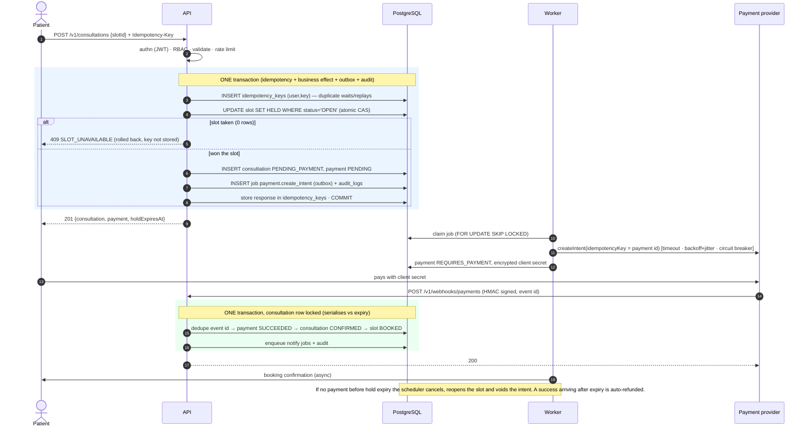
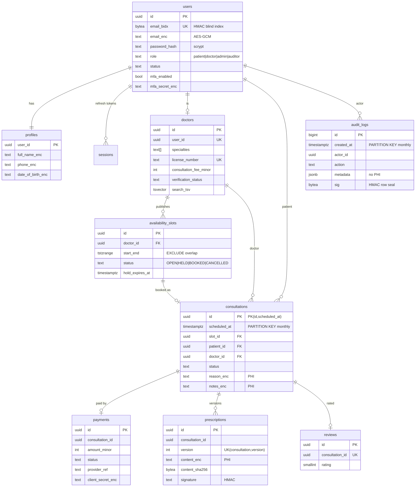
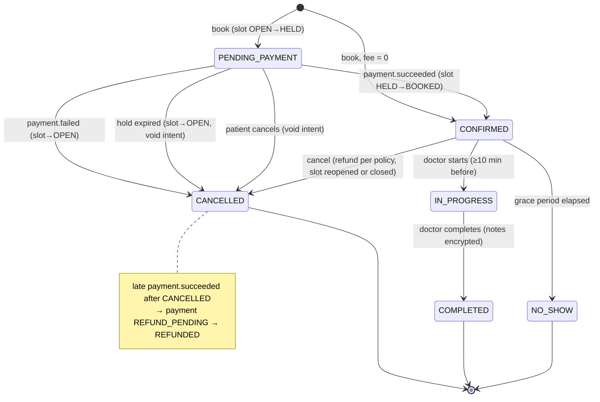

# Amrutam Telemedicine Backend — Architecture

> Scope: core workflows for 100k consultations/day with p95 < 200 ms reads / < 500 ms writes and 99.95% availability.
> Every claim below is backed by code in this repo; measured numbers are in [performance.md](performance.md).
> Diagrams are Mermaid (rendered copies in `docs/diagrams/*.svg`).

## 1. Context, constraints and the shape of the solution

**Load model.** 100k consultations/day ≈ 1.2/s average; assume a 10× diurnal peak ≈ 12 bookings/s. Each consultation drives ≈ 20 reads (search, slots, status polling) → ≈ 250 reads/s at peak, mostly cacheable. Storage ≈ 4 KB/consultation (row + payment + ≈ 8 audit rows) ≈ 400 MB/day ≈ 150 GB/year before compression — small enough for a single PostgreSQL primary with partitioning; no sharding is needed (see §9).

**Decision: modular monolith, two deployables.** One TypeScript codebase with module boundaries (`auth`, `doctors`, `consultations`, `payments`, `audit`, `jobs`, `admin`) wired through constructor injection in one composition root (`src/container.ts`). It deploys as **API pods** (stateless HTTP) and **worker pods** (job queue + scheduler). Rationale: the bottleneck at this scale is correctness under concurrency (double booking, payment races), not team autonomy — one transactional database gives us ACID across slot + consultation + payment + audit, which microservices would replace with distributed sagas everywhere. Module boundaries make a later split mechanical.

**Decision: PostgreSQL is the system of record *and* the queue.** Jobs live in a `jobs` table claimed with `FOR UPDATE SKIP LOCKED`. This gives a **transactional outbox for free** (the job exists iff the business transaction committed), removes a broker from the availability path, and handles our volume (hundreds of jobs/s) comfortably. Redis is strictly an optimisation (cache, revocation markers, rate-limit counters) and the system degrades — not fails — without it.

## 2. High-level architecture and data flow

**Read path:** WAF/ALB → API pod → authn (ES256 JWT verify + Redis revocation check) → RBAC → zod validation → Redis cache-aside → Postgres replica on miss.
**Write path:** same, then **one** primary transaction containing the idempotency record, the state change, any outbox job and the audit record. Nothing external (PSP, email) is called inside a request: external effects are always performed by workers from the outbox.
**Webhooks:** PSP → ALB → API; authenticated by HMAC over the raw body with a 5-minute replay window, deduplicated by event id.

## 3. Booking flow

Key properties: (1) the slot is claimed by a single atomic `UPDATE … WHERE status='OPEN'` — concurrent bookers queue on the row lock and the losers update zero rows, so double booking is impossible without any distributed lock; (2) a GiST *exclusion constraint* on `(doctor_id, time-range)` makes overlapping slots impossible even through a buggy code path; (3) a partial unique index allows only one live consultation per slot (defence in depth); (4) the patient holds the slot for `BOOKING_HOLD_SECONDS` (default 10 min) while paying.

## 4. Data model

Core tables requested: `users, profiles, doctors, availability_slots, consultations, prescriptions, payments, audit_logs` — plus `sessions` (refresh-token families), `reviews`, `idempotency_keys`, `jobs`, `webhook_events`, `recurring_tasks`, `analytics_daily`, `audit_checkpoints`. DDL: `migrations/*.sql` (applied by a checksummed, advisory-locked runner; forward-only, expand/contract for zero-downtime deploys).

**Data classification and encryption.** C4 (PHI/secrets: complaint, clinical notes, prescriptions, TOTP secrets, payment client secrets) and C3 (PII: email, name, phone, DOB) are encrypted **in the application** with AES-256-GCM (random IV per value, versioned key id, AAD bound to `table.column:rowId` so ciphertext cannot be swapped between rows). Email/phone lookups use an HMAC **blind index**. Storage-level KMS encryption sits underneath as a second layer. Details: [security/threat-model.md](security/threat-model.md).

## 5. API

REST, documented in [`openapi.yaml`](openapi.yaml) (OpenAPI 3.0.3, 45 operations). CI fails if the spec and the implemented routes drift (`scripts/check-openapi.ts`). Conventions: RFC 7807 errors; `Idempotency-Key` on resource-creating writes; opaque keyset cursors (no offset scans); ISO-8601 UTC; every response carries `X-Request-Id`, which also appears in logs, traces and audit rows.

## 6. Caching and concurrency handling

| Concern | Mechanism |
|---|---|
| Hot reads (doctor profile, search, open slots) | Redis cache-aside, TTL 10–60 s with ±10% jitter; **single-flight** per key per pod (stampede control); negative caching for missing ids |
| Invalidation | Version counters (`search:ver`, `slots:ver:<doctorId>`) bumped **after commit** (`tx.afterCommit`) — O(1) invalidation of whole key families; worst-case staleness is bounded by the TTL |
| Cache outage | Circuit breaker around Redis; reads fall through to Postgres; rate limiter falls back to per-pod memory. Never a hard dependency |
| Double booking | Atomic compare-and-set on the slot row + exclusion constraint + unique index (§3) |
| Pay-vs-expire race | Both paths lock the consultation row (`FOR UPDATE`); the loser observes the new state and compensates (§7). Covered by `test/integration/booking.test.ts` |
| Patient-level limits | `pg_advisory_xact_lock(patient)` serialises one patient's bookings so the pending-booking cap and overlap check are exact |
| State transitions | Consultations carry a `version` column bumped on every transition; all transitions run under a row lock |
| Deadlock / serialization | `db.tx` retries 40001/40P01 with jittered backoff; `lock_timeout=5s`, `statement_timeout`, `idle_in_transaction_session_timeout` bound every wait |

## 7. Transactions, idempotency and sagas

**Idempotency** (`Idempotency-Key`, required on booking and prescriptions): the key row is inserted *in the same transaction* as the effect and the response is stored before COMMIT. So effect and recorded response are atomic — a crash can never leave "done but unrecorded". Concurrent duplicates serialise on the primary-key insert and the loser replays the stored response; same key + different body → `422 IDEMPOTENCY_KEY_REUSED`; a failed attempt rolls back the key so the client can retry. Webhooks use event-id dedup; PSP calls use the payment id as the provider-side idempotency key; cancel/start/complete are naturally idempotent.

**Booking saga** (orchestrated in `consultations/booking.ts`; no 2PC):

| Step | Local transaction | Compensation if it later fails |
|---|---|---|
| Hold slot + create consultation/payment | slot `OPEN→HELD`, consultation `PENDING_PAYMENT`, payment `PENDING`, outbox job | hold expiry / failure → slot `OPEN`, consultation `CANCELLED` |
| Create PSP intent (worker) | payment `REQUIRES_PAYMENT` | PSP down → job retries with backoff; booking already safe. Payment voided meanwhile → intent voided |
| Payment succeeded (webhook) | payment `SUCCEEDED`, consultation `CONFIRMED`, slot `BOOKED` | success *after* cancellation/expiry → `REFUND_PENDING` → refund job (idempotent at PSP) |
| Cancel | consultation `CANCELLED`, slot reopened/closed | refund per policy (full ≥ 4 h before for patients; always for doctor/admin cancel) |

## 8. Retry and backoff strategy

| Where | Policy |
|---|---|
| Outbound PSP calls | per-attempt timeout 3 s → 3 attempts, exponential **full jitter** (100 ms base, 1.5 s cap), retry only retryable errors → **circuit breaker** (5 failures, 10 s cool-down, half-open probe). Business errors (card declined) never trip the breaker |
| Durable jobs | at-least-once; equal-jitter exponential backoff 2 s → 5 min cap; 8 attempts then **dead-letter** (alert + admin requeue endpoint); 60 s leases reclaim jobs from crashed workers; every handler is idempotent |
| DB transactions | 3 attempts on serialization/deadlock with jitter |
| Clients | `Retry-After` on 429/503; any write carrying an `Idempotency-Key` is safe to retry |
| Redis | 150 ms command timeout, no offline queue, breaker → degrade |

## 9. Partitioning and scale-out path

* **`consultations`** — RANGE partitioned by `scheduled_at`, monthly (≈ 3M rows/partition at target volume). Partitions are pre-created by the scheduler (`partitions.ensure`, 6 months ahead) with a `DEFAULT` partition as a safety net. Old partitions can be detached, compressed and archived.
* **`audit_logs`** — RANGE partitioned by `created_at`, monthly; append-only (triggers block UPDATE/DELETE/TRUNCATE); hash-chained **checkpoints** seal windows of row HMACs. Old partitions are detached to S3 Object Lock (WORM, 7 years) — the DB keeps a hot 12 months.
* **Everything else** is small (doctors, slots inside the booking horizon) or short-lived (jobs, idempotency keys, swept hourly).
* **Reads**: search/analytics use Aurora readers (`DATABASE_READ_URL`); analytics read a **pre-aggregated rollup**, never the OLTP tables.
* **Scaling levers, in order**: API HPA (CPU) → readers → larger writer → RDS Proxy/PgBouncer → hash-sharding by `doctor_id` (slot ownership is naturally per-doctor, so the booking transaction stays single-shard). The last step is not needed below roughly 10× the target.

## 10. Availability, backup and disaster recovery (target 99.95% ≈ 22 min/month)

* **Multi-AZ everywhere**: 6+ API pods spread over 3 AZs (`topologySpreadConstraints`, PDB `minAvailable: 4`, `maxUnavailable: 0` rolling updates, `preStop` drain), Aurora writer + 2 readers across AZs (automatic failover, typically < 30 s), ElastiCache multi-AZ, one NAT gateway per AZ.
* **Stateless pods + durable queue**: any pod/worker can die at any time; leases and idempotency make retries safe.
* **Backups**: Aurora continuous backup with **35-day PITR**, daily AWS Backup snapshots copied to a **second region** under a vault lock (ransomware-resistant), monthly 1-year snapshots, KMS multi-region replica key. Audit archive in S3 Object Lock.
* **Targets**: AZ loss — RPO 0, RTO < 1 min (automatic). Writer loss — RPO 0, RTO ≈ 30 s. Logical corruption / bad migration — PITR clone, RPO ≈ 5 min, RTO 30–60 min. Region loss — restore from cross-region backup, RPO ≤ 24 h (≈ seconds with Aurora Global Database, the recommended upgrade), RTO ≈ 2 h. Runbooks and the quarterly restore-test procedure: [runbooks/disaster-recovery.md](runbooks/disaster-recovery.md). *These are design targets; they have not been exercised against a real cloud account.*

## 11. Observability

* **Metrics** (Prometheus, separate internal port): RED per route template, DB latency/pool, cache hit ratio, queue depth and *oldest pending age*, booking outcomes, saga compensations, payment events, circuit state, auth/abuse events, scheduler health. Dashboard: `infra/observability/grafana/dashboards/overview.json`.
* **Logs**: structured JSON (pino) with `requestId`, `traceId`, `userId`; secrets/PII redacted in the serializer (unit-tested).
* **Traces**: OpenTelemetry (HTTP, pg, ioredis, plus spans for jobs and scheduled tasks) → collector with tail sampling (all errors and > 400 ms, 10% of the rest) → Jaeger/Tempo. Grafana links log lines to traces via `traceId`.
* **Alerts** (`infra/observability/alerts.yml`): multi-window multi-burn-rate alerts for the 99.95% objective, p95 read/write latency, queue backlog, dead letters, circuit open, saga-compensation rate, DB pool saturation, audit write failures, refresh-token reuse, login-failure spikes.

## 12. Trade-offs and known limitations (read before production)

* The payment provider is a **mock adapter** behind `PaymentGateway`; a real PSP adapter and webhook mapping still need to be written. Production config *refuses to start* with the mock unless `ALLOW_MOCK_PAYMENTS=true`.
* Notifications are a logging adapter behind `Notifier`; no real email/SMS/push yet. No video/chat transport — this service owns scheduling, state, prescriptions and compliance.
* Single active region (warm standby via backups). Active/active would need conflict-free slot ownership.
* Search uses Postgres FTS + trigram (fine to ≈ 100k doctors); beyond that, move to OpenSearch fed from the outbox.
* `consultations` lookups by id alone probe each partition's id index — fine for tens of partitions; if it ever matters, embed `scheduled_at` in the public id.
* Audit-HMAC, blind-index and signing-key rotation is documented but re-keying historical rows needs a key-id column ([security/key-management.md](security/key-management.md)); data-encryption keys and JWT keys rotate online today.
* Terraform and Kubernetes manifests were syntax-checked but **not applied** to a real cloud account, and the container image was not built in the authoring sandbox (no Docker daemon); CI builds and scans it.
